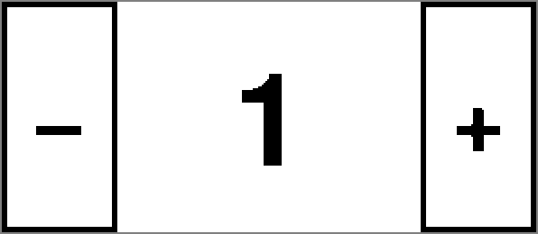
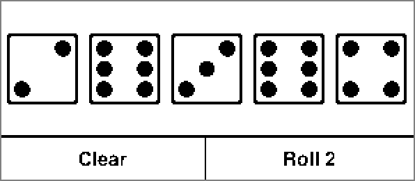
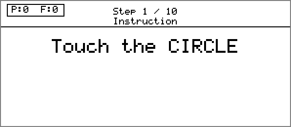

# pux4j-native

Native images of the [pux4j](https://github.com/darranl/pux4j) apps, to run on a Raspberry Pi without Java.

`pux4j` shows JavaFX apps on WaveShare eInk displays (see its README for what it is and for the four
demo apps). The displays come as a **HAT** ("Hardware Attached on Top"): an add-on board that plugs onto
the Raspberry Pi's pins. Here a HAT is a WaveShare eInk display with a touch screen, and two are
supported: the 2.9" Touch e-Paper HAT (V2) and the 2.13" Touch e-Paper HAT (V4).

The `pux4j` apps normally run on a Java runtime. This project builds each app instead as a
**native image**: one ordinary executable file that runs on a Raspberry Pi with no Java installed.
You build the images on an x86_64 Linux machine and copy them to the Pi. The build and these
instructions are tested on Arch Linux, x86_64; the target is Raspberry Pi OS 12 (Debian bookworm),
64-bit. Building a native image on the Raspberry Pi itself is not supported yet.

You can also build the same apps as native images that run on the x86_64 machine, using the
emulator, with no Pi and no cross-compiler. That is the quickest way to see this project work, and
it comes first below.

---

## What is a native image?

Normally a Java program is compiled to bytecode, and a **Java runtime** (the JVM) that is installed
on the machine runs it. That is how the `pux4j` bundles run on a Pi: Java 25 has to be installed there.

A **native image** is the same program compiled *ahead of time*, before it runs, by GraalVM's
`native-image` tool. The result is one ordinary executable for one operating system and one type of
processor (an *architecture*, here `x86_64` for a PC and `aarch64` for a 64-bit Raspberry Pi).

**What you get:**
- No Java on the Pi. You copy one file per app and run it.
- Programs that usually start faster and use less memory than on a Java runtime (this project does not
  measure that yet; the images are 32 to 46 MB each).

**What it costs:**
- A separate, slower build: one to two minutes per image, and GraalVM CE 25 on the build machine.
- An image runs on one architecture only. A Pi image (`aarch64`) is built on an x86_64 machine, which
  is called **cross-compiling**, and most of the set-up below exists to make that work.
- Everything Java normally discovers while running, such as reflection, resources and service
  providers, has to be declared when the image is built (**reachability metadata**). If something is
  missing, the app fails when it runs rather than when it is built, for example with a
  `ClassNotFoundException`.
- One image per app and per HAT: to change HAT, build again.
- Tools that attach to a running JVM, such as agents, do not work with a native image.

If you only want to try `pux4j`, its JVM bundles are simpler. This project is for running on a Pi
without Java.

---

## The four demo apps

Each app is its own native image and contains that app only. They are the same four apps that
`pux4j` ships; [The four demo apps](https://github.com/darranl/pux4j#the-four-demo-apps) in its
README describes them in more detail.

| App | What it is | What it looks like |
|---|---|---|
| `demo` | A counter. Tap the **−** and **+** buttons to change the number. |  |
| `dice-demo` | Five dice. Roll them up to three times in a turn; before the second and third roll, tap a die to save it. **Clear** starts again. |  |
| `smoke` | A quick check of the display. It draws a short series of test patterns and ends with PASS or FAIL. It does not use touch. | not captured yet |
| `validation` | A step-by-step check of the display and the touch screen. It asks you to tap targets on the panel and reports PASS or FAIL for each of its 10 steps, then writes a report file. |  (its first step) |

The pictures are the same frames as in the `pux4j` README: what `pux4j` sends to the 2.9" panel
(296×128), captured without hardware from the Java build.

`demo` and `dice-demo` are **JavaFX apps**. `smoke` and `validation` are **driver tests** that talk to
the display and touch hardware directly, without JavaFX.

---

## How this project fits with pux4j

`pux4j` is a standalone Java library; no native-image machinery lives there. This project takes the
`pux4j` jars from your local Maven repository (`~/.m2`) and turns them into native images.
Nothing here builds or installs `pux4j`, so **build and install it first**, in its root:

```bash
mvn install
```

This also runs `pux4j`'s tests. Fix any failure there before building a native image. After any
change to `pux4j`, install it again before rebuilding here.

You build with Maven **profiles**, named switches that choose what goes into a build. Every build
here uses two: one for the app and one for the target.

| Axis | Profile | Selects |
|---|---|---|
| App | `smoke` | the display smoke test, for a HAT |
| App | `validation` | the display and touch validation test, for a HAT |
| App | `demo` | the counter, through the generic launcher |
| App | `dice-demo` | the dice app, through the generic launcher |
| App | `smoke-emulator` | the smoke test against the emulator (build machine only) |
| App | `validation-emulator` | the validation test against the emulator (build machine only) |
| Target | `x86_64` | the emulator, runs on the build machine |
| Target | `hat-2in9v2` | the 2.9" V2 HAT drivers, cross-compiled for the Pi |
| Target | `hat-2in13v4` | the 2.13" V4 HAT drivers, cross-compiled for the Pi |

The HAT profiles here, `hat-2in9v2` and `hat-2in13v4`, name the same HATs as `pux4j`'s
`bundle-hat-2in9v2` and `bundle-hat-2in13v4`. Combine them like this: `demo` and `dice-demo` go with `x86_64` or a `hat-…`
profile; `smoke` and `validation` go with a `hat-…` profile only; `smoke-emulator` and
`validation-emulator` go with `x86_64` only.

The image is `target/pux4j-<app>-<target>`, for example `target/pux4j-demo-x86_64` or
`target/pux4j-demo-hat-2in9v2`. `-Dpux4j.version=<v>` selects the `pux4j` artifacts.

---

## Try it: a native image on your build machine

No Raspberry Pi, cross-compiler or container is needed for this. The image contains the emulator, a
window on your screen that behaves like the eInk panel; the mouse stands in for touching it.

**You need:**
- an x86_64 Linux machine with a desktop session (tested on Arch Linux);
- Maven, and GraalVM CE 25 as your Java (`JAVA_HOME` must contain `bin/native-image`);
- `pux4j` installed, as above;
- a GitHub Packages token in `~/.m2/settings.xml`, because one dependency of every build here
  (metadata for Pi4J, see [Reachability metadata](#reachability-metadata-what-the-image-is-told)) is
  hosted there. Give the token the `read:packages` scope:

```xml
<servers>
  <server>
    <id>github</id>
    <username>YOUR_GITHUB_USERNAME</username>
    <password>YOUR_READ_PACKAGES_PAT</password>
  </server>
</servers>
```

GraalVM CE 25 via SDKMAN:

```bash
sdk install java 25.3.4-graalce
sdk use java 25.3.4-graalce
```

From the root of this project:

```bash
mvn package -P demo,x86_64                    # build the counter as an x86_64 native image
scripts/run-demo-emulator.sh                  # run it: the emulator window opens

mvn package -P dice-demo,x86_64
scripts/run-dice-demo-emulator.sh             # the same options: --display=ssd1680, --scale=N

mvn package -P smoke-emulator,x86_64          # the smoke and validation tests, against the emulator
scripts/run-smoke-emulator.sh                 # --display=ssd1680 for the 2.13" panel, --scale=N to zoom

mvn package -P validation-emulator,x86_64
scripts/run-validation-emulator.sh            # writes its report file into the current directory
```

Each image takes one to two minutes to build. This is an emulator build, so you only check that the
native image works, not the Pi hardware.

---

## Building for the Raspberry Pi: what cross-compiling needs

A native image for the Pi has to be compiled for the Pi's processor, but you build it on an x86_64
machine. The compiler therefore needs the Pi's C libraries and headers, a C compiler that produces
Pi code, and some facts about the Pi that it cannot measure on the build machine. The pieces below
provide that. You set most of them up once; `scripts/deploy.sh` then uses them.

| Piece | What it is | Emulator image | Pi image |
|---|---|---|---|
| GraalVM CE 25 | The JDK that contains `native-image` | yes | yes |
| `pux4j` in `~/.m2` | The Java jars that become the image | yes | yes |
| GitHub Packages token | Lets Maven download one dependency | yes | yes |
| Reachability metadata | Tells the build what to keep | yes | yes |
| Cross-compiler | A C compiler that outputs Pi code | no | yes |
| Podman and the builder image (sysroot) | The Pi's libraries and headers | no | yes |
| aarch64 static libraries | Pi versions of GraalVM's own libraries | no | yes |
| QEMU binfmt | Runs Pi programs on the x86_64 machine | no | yes |
| CAP cache | Facts about the Pi's C types | no | yes |
| `CABI` flag | Tells the build the Pi's calling convention | no | yes |
| Enforcer rules | Keep one app and one HAT per image | HAT builds | yes |

**Cross-compiler.** `native-image` produces C-compatible output and hands the last compile and link
step to a C compiler. Here that is `aarch64-linux-gnu-gcc` (on Arch Linux: `pacman -S aarch64-linux-gnu-gcc`),
and the build looks for it at `/usr/bin/aarch64-linux-gnu-gcc`. If it is missing, the build stops
when it tries to run it.

**Sysroot.** A *sysroot* is a copy of the target machine's file system that a cross-compiler uses in
place of your own `/usr/include` and `/usr/lib`. Here it is the
[graalvm-pi-builder](https://github.com/lofthouse-dev/graalvm-pi-builder) container image: Debian
bookworm for arm64 with GraalVM CE 25 and the aarch64 libraries. **Podman** pulls it and `deploy.sh`
mounts it read-only for the build (inside `podman unshare`, so no root is needed), once for all the
apps you build. The build is given its path as `-Dsysroot=`. Without it the compiler would use your
x86_64 libraries and produce a broken image. The image is arm64-only, so pulling it on an x86_64
machine needs `--platform`; do it once:

```bash
podman pull --platform=linux/arm64 ghcr.io/lofthouse-dev/graalvm-pi-builder:bookworm-25.3.4.1
```

**aarch64 static libraries.** A native image links in GraalVM's own static libraries. For a Pi image
those must be the aarch64 versions, which are inside the builder image. `scripts/setup-aarch64-libs.sh`
(run by `deploy.sh` for you) adds two symbolic links inside your local GraalVM installation, in
`lib/static/` and `lib/svm/clibraries/`, pointing at the mounted image. It changes your GraalVM
directory, and it refuses if a real directory is in the way. Keep your GraalVM version in step with
the one in the builder image.

**QEMU binfmt.** QEMU can run programs built for another processor, and *binfmt* makes Linux use it
automatically. It is needed only to run the arm64 container that creates the CAP cache, on the first
build. On Arch Linux:

```bash
sudo pacman -S qemu-user-static-binfmt
sudo systemctl restart systemd-binfmt
```

If it is not set up, `scripts/generate-cap-cache.sh` stops and says how.

**CAP cache.** To compile calls to C, the build needs the sizes and layout of C types on the target.
Normally it learns them by compiling and *running* small C programs, which cannot run on x86_64 when
the target is aarch64. So the cache of those facts is generated once, inside the arm64 container
under QEMU, and kept in `target/cap-cache/`; the first build creates it and later builds, for every
app, reuse it. Regenerate it with `mvn clean` after a GraalVM upgrade or a Debian bookworm glibc
update. It is not used for the `x86_64` target.

**The `CABI` flag.** The build passes `-J-Djdk.internal.foreign.CABI=LINUX_AARCH_64`, so that the
build's own JVM uses the Pi's calling convention for foreign calls rather than your machine's.
Without it, cross-compiling fails with a `ClassCastException` in `ForeignFunctionsFeature`. It is
set in `pom.xml`, so you do not pass it yourself.

### Reachability metadata: what the image is told

A native image only contains what the build can see is used. Things Java finds at run time, such as
reflection, resources, service providers and Pi4J's calls to C through the Foreign Function and
Memory API, have to be declared. That is the *reachability metadata*. It lives in two places: one
JSON file in this project, shared by every app and target (see
[`metadata-notes.md`](metadata-notes.md) for its history and how to extend it), and the
`pi4j-ffm-metadata-bookworm-graal25` artifact for Pi4J's calls, which is the dependency that needs
the GitHub Packages token. This project also contains one small class, `QuantumToolkitSubstitution`,
that works around a JavaFX start-up race that only occurs in a native image.

### Enforcer: one app and one HAT per image

An image must contain one app only, and for a HAT build neither the emulator nor a second HAT's
drivers. Maven Enforcer rules in the app and HAT profiles of `pom.xml` fail the build if any of those
reaches the dependency tree, and a second check, just before packaging, fails it if the wrong jars are
in the directory the image is built from (`target/deps-<target>/`). `smoke` and `validation`
additionally forbid JavaFX and the launcher. The `x86_64`, `smoke-emulator` and `validation-emulator`
profiles have no such rules, because the emulator belongs in those images.

In the `demo` and `dice-demo` directories you will see `javafx-base-<v>.jar` and
`javafx-controls-<v>.jar` of about 300 bytes next to the `-linux-aarch64` platform jars. That is
normal: OpenJFX publishes manifest-only placeholder jars under the plain names, and they cannot clash
with the platform jars.

---

## Build and deploy to a Raspberry Pi

**You also need:** the pieces in the table above for a Pi image (cross-compiler, Podman with the
builder image pulled, QEMU binfmt), and a Pi running Raspberry Pi OS 64-bit with SPI and I2C
enabled, `tar`, and for the JavaFX apps a desktop session. **The Pi needs no Java.**

The HAT is chosen when you build, not detected on the Pi. Build for the HAT that is attached.

| HAT | Build target (`<hat>`) | Tested on |
|---|---|---|
| 2.9" Touch e-Paper HAT (V2) — SSD1675A display, ICNT86X touch | `hat-2in9v2` | Raspberry Pi 500+ |
| 2.13" Touch e-Paper HAT (V4) — SSD1680 display, GT1151Q touch | `hat-2in13v4` | Raspberry Pi Zero 2 W |

A mismatch does not produce an error: the panel simply shows nothing sensible.

`scripts/deploy.sh` cross-compiles the apps you name for one HAT and copies them to a Pi. It never
builds or installs `pux4j`; it checks that the `pux4j` artifacts are in the local Maven repository
and says so if they are not.

```bash
sdk use java 25.3.4-graalce                       # JAVA_HOME must be GraalVM CE
scripts/deploy.sh <host> <hat> <app>...           # for example: scripts/deploy.sh mypi hat-2in9v2 smoke demo
scripts/deploy.sh <host> <hat> --all              # all four apps (the sysroot is mounted once)
```

| Option | Effect |
|---|---|
| `--user <user>` | ssh user, if different from what ssh would choose |
| `--dir <dir>` | directory on the Pi that will contain `pux4j-native` (default `applications`, so `~/applications/pux4j-native`) |
| `--pux4j-version <v>` | version of the `pux4j` artifacts to build against (default: `pux4j.version` in `pom.xml`) |
| `--repo <dir>` | local Maven repository (default `~/.m2/repository`) |
| `--settings <file>` | Maven settings file (default `~/.m2/settings.xml` when it exists) |
| `--skip-build` | deploy the images already in `target/` without building |
| `--dry-run` | print what would be done without building, connecting or changing anything |

`--help` prints the full text. On the Pi the script runs read-only checks (aarch64, SPI and I2C
devices, `tar`), then adds or replaces `lib/<app>` for the apps given and replaces `bin/`. Other
apps in `lib/` and the `logs/` directory are left alone, so you can deploy one app at a time. A
failed transfer leaves the previous installation working. Finally it runs `bin/install.sh`, which
links `pux4j-native` into `~/bin` (creating it if needed).

Each image takes one to two minutes to build. The build prints three warnings (the deprecated
`--no-fallback` option, the deprecated `FallbackThreshold`, and the host CPU falling back to
`-march=compatibility`); all are expected.

Under the hood `deploy.sh` runs, for each app, `mvn package -P <app>,<hat> -Dsysroot=<sysroot>`;
you rarely need to run that yourself.

---

## Run on the Raspberry Pi

```bash
pux4j-native --list                  # the apps installed on this Pi
pux4j-native demo
pux4j-native validation --start-step 3
```

(If `~/bin` is not on the `PATH` yet, run `~/applications/pux4j-native/bin/pux4j-native`, or log
out and back in.)

- **App name** is the first argument that does not start with `-`. It is optional while only one
  app is installed. Exit codes: 0 success, 1 failure, 2 usage error (unknown or missing app).
- **Arguments:** `-D<property>=<value>` sets a system property for the app. For `smoke` and
  `validation`, everything else after the name goes to the test unchanged. The JavaFX apps
  (`demo`, `dice-demo`) ignore further arguments.
- **`DISPLAY`** defaults to `:0`. The JavaFX apps need a desktop session on the Pi even though
  nothing is shown on it, and `DISPLAY` must point at that session: `export DISPLAY=:1` first if
  the desktop is on `:1`. `smoke` and `validation` do not need one.
- **Logs:** output goes to the terminal and to `~/applications/pux4j-native/logs/<app>.log`,
  replaced on every run of that app. `--list` and `--help` write no log.

Nothing installed on the Pi carries a HAT name, and the installation does not record which HAT it
was built for. Keep track of which HAT you deployed to which Pi.

---

## Tests

`scripts/deploy-test.sh` tests the deploy script and the Pi-side dispatcher without a Pi, podman or
network, using a fake `ssh` and tiny stand-in images. It does not build a native image.

```bash
scripts/deploy-test.sh
```

## Maintenance notes

- **`pux4j` version** — `<pux4j.version>` in `pom.xml` is the default; override it with
  `-Dpux4j.version` or `deploy.sh --pux4j-version`.
- **`pi4j-ffm-metadata-bookworm-graal25`** — reachability metadata for Pi4J's FFM downcalls. Version
  `4.0.2-0` is aligned with Pi4J 4.0.2. If `pux4j` upgrades Pi4J, update this version and publish a new
  artifact from [lofthouse-dev/pi4j-graalvm-metadata](https://github.com/lofthouse-dev/pi4j-graalvm-metadata).
- **The builder image** — to move to a new image tag, change `IMAGE` in `scripts/deploy.sh` and
  `IMAGE_TAG` in `scripts/generate-cap-cache.sh`. Source and rebuild instructions (a
  `workflow_dispatch` run of the repository's build workflow) are in the
  [graalvm-pi-builder](https://github.com/lofthouse-dev/graalvm-pi-builder) repository.
- **Regenerating metadata** — see [`metadata-notes.md`](metadata-notes.md), including a known gotcha
  with `scripts/generate-metadata.sh` on the currently installed GraalVM version; read it before
  running that script.

## Future: native shared library

This project is expected to grow into a multi-module project when a native shared library is
added: `@CEntryPoint` wrappers over `EInkDisplayDriver`, `TouchDriver` and `RenderSession`,
compiled with `--shared` to produce a `.so` and a C header callable from C, Python and Rust.
